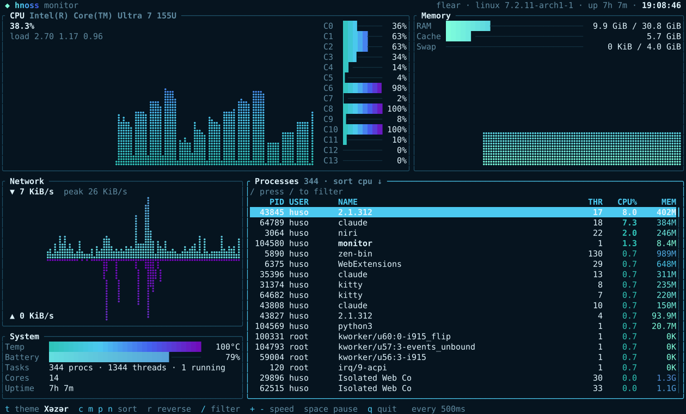

# hnoss

**hnoss** is an immediate-mode, widget-rich TUI library for [Odin](https://odin-lang.org).


<sub>`examples/monitor`: a live system monitor in about 700 lines, reading `/proc` directly.
Braille graphs, gradient meters, a sortable, filterable process table, four themes.
Above: **Odlar Yurdu**; below: **Xəzər**.</sub>



## Goals

- **Pure Odin.** Only `core:` and `base:`. No ncurses, no termbox, no C.
- **Immediate mode.** Every frame you describe the whole UI; hnoss diffs it against
  the previous frame and writes the minimal ANSI to the terminal.
- **Batteries included**: layout, styled text and a real widget set, designed for
  Odin rather than ported from another language.
- **Explicit allocators.** Per-frame scratch lives in `context.temp_allocator`.
- **No hidden global state**, apart from one terminal-restore hook.
- **The terminal is always restored** (raw mode, cursor, alt screen), even on panic or signal.
- Linux first; the platform code sits behind a small backend so macOS/Windows can follow.

## Status

Early work. See the roadmap below. What exists today:

```odin
term, err := hnoss.init()
defer hnoss.deinit(&term)
for running {
    for ev in hnoss.poll_events(&term, 16) {   // keys, mouse, paste, resize
        if hnoss.is_char(ev, 'q') { running = false }
    }
    f := hnoss.begin_frame(&term)          // picks up resizes
    hnoss.markup(f, {2, 1, 40, 1}, "[b]CPU[/] [red]92%[/]")
    hnoss.end_frame(&term)                 // diff vs last frame, one write
}
```

Text is written with a **pen**: it flows styled text straight into the frame, wrapping
(word / char / clip / ellipsis), aligning and scrolling as it goes, with no intermediate
text objects. Markup is a thin layer on the same pen.

```odin
p := hnoss.pen(f, area, wrap = .Word, align = .Center)
hnoss.write(&p, "CPU ", {add = {.Bold}})
hnoss.write(&p, fmt.tprint(cpu), {fg = .Red})
hnoss.finish(&p)

lines, widest := hnoss.measure(article, width = 40)   // same pen, nothing drawn
```

Layout is plain Rect math, no solver and no allocation. Cut pieces off the edges,
or split proportionally (a number is cells; `percent` and `fill` share the rest):

```odin
area := f.area
header := hnoss.cut_top(&area, 1)
sidebar := hnoss.cut_left(&area, 26)
rows := hnoss.split(area, .Vertical, {hnoss.percent(40), hnoss.fill(), 3}, gap = 1)
cols := hnoss.split(rows[0], .Horizontal, {hnoss.fill(2), hnoss.fill(1)})
dialog := hnoss.center(f.area, 44, 7)
```

Widgets are procedures. Calling one draws it, handles the input meant for it and
reports what happened. State you own is passed by pointer and doubles as the
widget's identity for focus; events a widget consumes don't reach the app:

```odin
events := hnoss.poll_events(&term, 16)
f := hnoss.begin_frame(&term)
ui := hnoss.ui(f, events)
hnoss.focus_order(ui, {&list, &search})        // Tab / Shift+Tab

if hnoss.list(ui, hnoss.box(ui, left, "Processes"), names, &list) {
    // selection changed (keys, click, wheel)
}
if hnoss.input(ui, field, &search, {placeholder = "filter…"}) {
    // text changed; typing "q" here does not quit
}
hnoss.gauge(ui, bar, cpu)
for ev in hnoss.unhandled(ui) {
    if hnoss.is_char(ev, 'q') { running = false }
}
hnoss.end_frame(&term)
```

All colors come from `ui.theme`, so restyling an app is one assignment.

Widths come from a table generated from Unicode 16 data, and text is handled in
grapheme clusters: `世界`, `é`, `👩‍💻`, `🇦🇿`, `🇹🇷`, `Salam, dünya!` all wrap and align correctly.

Rendering is double-buffered: each frame is diffed against the previous one and only
changed cells are written, with cursor moves and SGR codes emitted only when needed,
inside a synchronized-output block so the terminal never shows a torn frame.
A 200x60 frame where every cell changes color diffs in ~2 ms; an unchanged frame in ~0.07 ms.

| Phase | Scope | State |
|---|---|---|
| 0 | Scaffold | done |
| 1 | Backend + restore safety | done |
| 2 | Buffer + diff renderer | done |
| 3 | Input parser | done |
| 4 | Style, text, unicode width | done |
| 5 | Layout | done |
| 6 | Widgets | done |
| 7 | Demo app (system monitor) | done |

## Layout

```
backend/   terminal I/O: raw mode, alt screen, size, write, input bytes
input/     byte stream -> Event (Key, Mouse, Resize, Paste)
buffer/    Cell, Buffer, double-buffer diff -> minimal ANSI
style/     Color, Modifier, Style
layout/    Rect, cuts, split (cells / percent / fill), grid, center
text/      unicode width, grapheme clusters, truncate
pen/       styled text writer: wrap, align, scroll, markup
widgets/   box, label, paragraph, list, table, gauge, sparkline, tabs, scrollbar, input
examples/  one runnable example per feature
tests/     `odin test` suites
bench/     render pipeline benchmark
tools/     width-table generator, pty test harness, ANSI-to-SVG screenshots
```

## Building

```sh
./build.sh            # check + test + build examples into bin/
./build.sh check
./build.sh test
./build.sh run monitor       # the system monitor above (t: theme, c m p n: sort, /: filter)
./build.sh run w_list        # one example per widget: w_box w_paragraph w_list w_table
                             #   w_gauge w_sparkline w_tabs w_scrollbar w_input
./build.sh run layout        # cuts, split, grid, centered dialog
./build.sh run text          # pen + markup, reflows on resize
./build.sh run event_inspector  # shows every key / mouse / paste / resize event
./build.sh run plasma        # full-screen truecolor animation at 60 fps
./build.sh run backend_box   # q / Ctrl+C quits, p panics (terminal still comes back clean)
./build.sh bench             # time fill + diff for a 200x60 frame
```

## License

MIT
