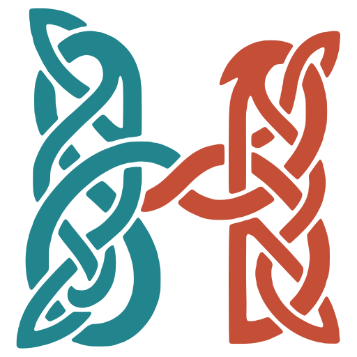
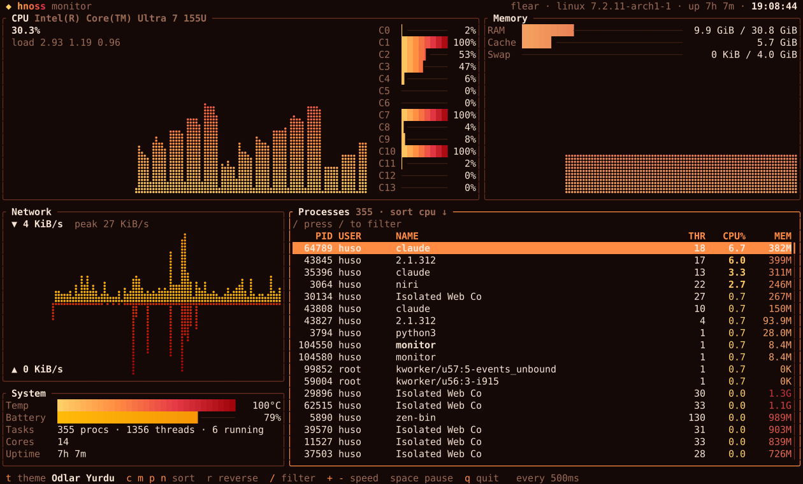
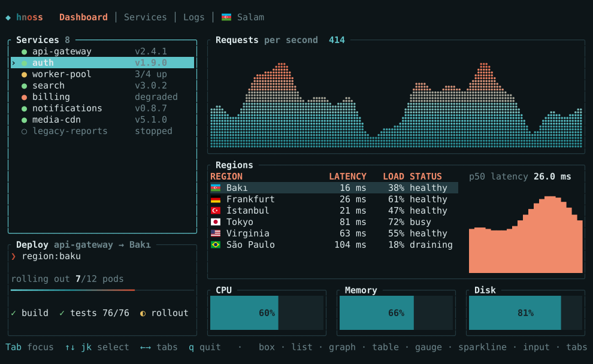
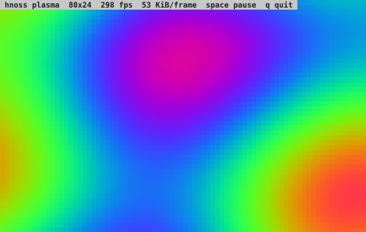
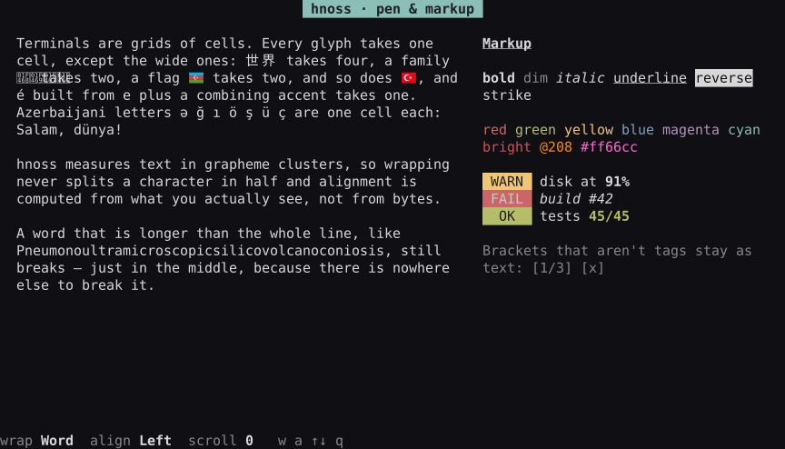
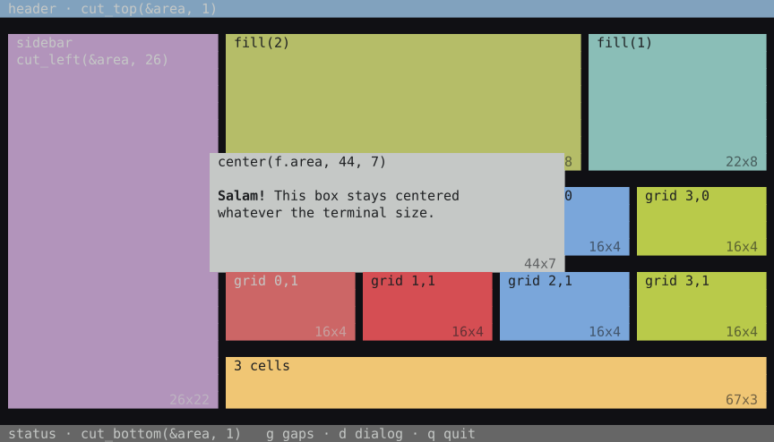
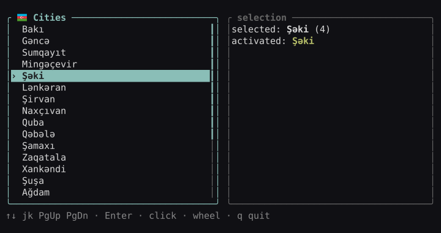
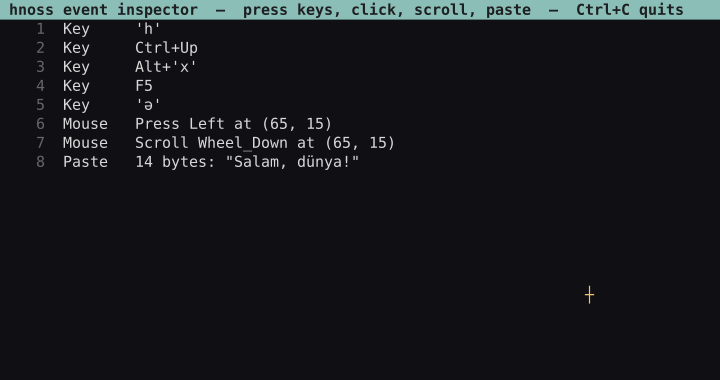

<p align="center">
  
</p>

<h1 align="center">hnoss</h1>

<p align="center">
  An immediate-mode TUI library for <a href="https://odin-lang.org">Odin</a>. Pure Odin, no C, batteries included.<br>
  <a href="https://huseynteymurzade28.github.io/hnoss/"><b>Documentation</b></a> ·
  <a href="https://huseynteymurzade28.github.io/hnoss/guide.html">Guide</a> ·
  <a href="https://huseynteymurzade28.github.io/hnoss/widgets.html">Widgets</a> ·
  <a href="examples/">Examples</a>
</p>



<p align="center"><sub><code>examples/monitor</code>: a live system monitor reading <code>/proc</code>, in the <b>Odlar Yurdu</b> theme.</sub></p>

## Gallery

| | | |
|:-:|:-:|:-:|
| <br>**Widgets**<br><sub>tabs, lists, braille graph, table, gauges, input</sub> | <br>**Truecolor at 60 fps**<br><sub>double-buffered diff, one write per frame</sub> | <br>**Text & markup**<br><sub>wrapping by grapheme, `[b red]markup[/]`</sub> |
| <br>**Layout**<br><sub>cuts, split, grid, center</sub> | <br>**Stateful widgets**<br><sub>keyboard, mouse, focus</sub> | <br>**Input**<br><sub>keys, modifiers, mouse, paste</sub> |

## Quick start

```odin
import hnoss "hnoss"

main :: proc() {
    term, _ := hnoss.init(hnoss.DEFAULT_OPTIONS + {.Mouse_Capture})
    defer hnoss.deinit(&term)           // the terminal is always restored, even on panic or Ctrl+C

    cities := []string{"Bakı", "Gəncə", "Şəki", "Lənkəran"}
    list: hnoss.List_State
    events: []hnoss.Event
    for {
        f := hnoss.begin_frame(&term)
        ui := hnoss.ui(f, events)
        inner := hnoss.box(ui, hnoss.inset(f.area, 1), "🇦🇿 [b]Cities[/]")
        hnoss.focus(ui, &list)
        hnoss.list(ui, inner, cities, &list)          // ↑↓, click, wheel

        for ev in hnoss.unhandled(ui) {
            if hnoss.is_char(ev, 'q') { return }
        }
        hnoss.end_frame(&term)                        // diff, one write
        free_all(context.temp_allocator)
        events = hnoss.poll_events(&term, -1)
    }
}
```

## Why hnoss

- **Pure Odin.** Only `core:` and `base:`; raw syscalls on Linux, no ncurses, no libc bindings.
- **Immediate mode.** Calling a widget draws it, handles its input and returns what happened.
- **Fast.** Only changed cells are written; a full 200×60 truecolor frame diffs in ~2 ms.
- **Correct text.** Unicode 16 widths and grapheme clusters: `世界`, `é`, `👩‍💻`, `🇦🇿`.
- **Safe.** Raw mode, alt screen and cursor are restored on exit, panic and signals.

## Build

```sh
./build.sh                 # check + tests + all examples into bin/
./build.sh run showcase    # or: monitor, plasma, text, layout, event_inspector, w_<widget>
```

Linux today; the platform layer is one small file so macOS/Windows can follow.

## License

MIT
